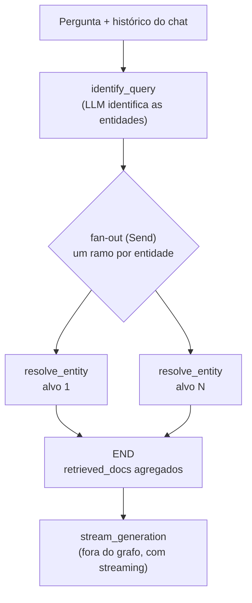
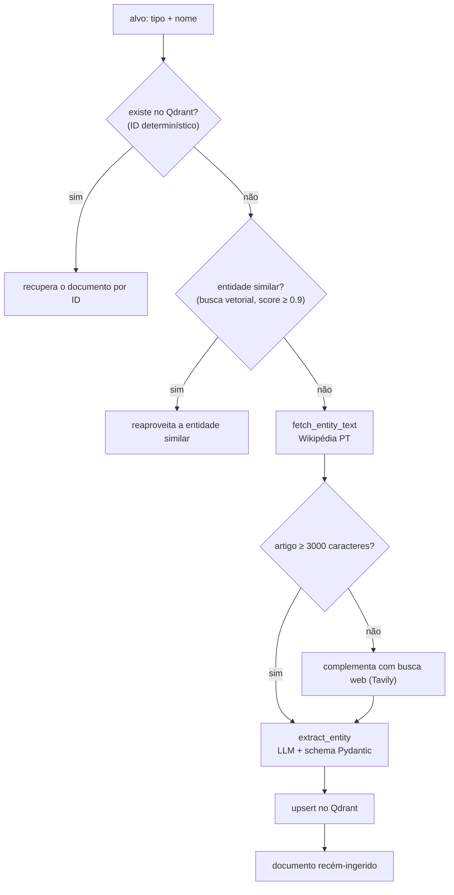

# FuteRAG

Sistema de **RAG Centrado em Entidades** para o domínio do futebol. Em vez de fatiar textos em chunks arbitrários, o FuteRAG usa uma LLM local como agente extrator: ela lê artigos da web, converte o conteúdo em objetos estruturados e tipados (Pydantic) e os armazena em um banco vetorial (Qdrant) que permite filtros exatos sobre metadados.

> Código em inglês, interface e prompts em português.

---

## Sumário

1. [A ideia](#a-ideia)
2. [Fluxo do LangGraph](#fluxo-do-langgraph)
3. [Estrutura do projeto](#estrutura-do-projeto)
4. [Tecnologias](#tecnologias)
5. [Passo a passo para rodar](#passo-a-passo-para-rodar)
6. [Como usar](#como-usar)
7. [Variáveis de ambiente](#variáveis-de-ambiente)
8. [Limitações conhecidas](#limitações-conhecidas)
9. [Próximos passos](#próximos-passos)
10. [Solução de problemas](#solução-de-problemas)

---

## A ideia

O projeto nasceu de um problema clássico: perguntas relacionais como *"quem jogou no Milan **e** no Fluminense?"* são difíceis de responder com RAG tradicional. Quando o texto é dividido em chunks, a informação de um mesmo jogador fica espalhada e o contexto se perde.

A abordagem do FuteRAG é inverter a lógica:

| RAG tradicional | RAG Centrado em Entidades (FuteRAG) |
|---|---|
| Fatia o texto em chunks | Extrai uma entidade completa por documento |
| Embeddings de trechos soltos | Embedding do `summary` + payload estruturado |
| Filtra só por similaridade | Combina similaridade com filtros exatos de metadados |

Cada documento guardado no banco é uma entidade (`Player`, `Coach`, `Stadium`, `Team`, `Competition` ou `Match`), definida em `src/chunking/schema.py`. O embedding é gerado a partir do campo `summary`, e todo o restante (clubes, títulos, nacionalidades, etc.) vai como payload, o que permite filtrar por esses campos.

O banco **começa vazio** e é populado sob demanda: ao perguntar sobre uma entidade que ainda não existe, o sistema busca a informação na web, extrai, grava e responde.

---

## Fluxo do LangGraph

O grafo cuida da **recuperação e ingestão**. A **geração da resposta fica fora do grafo**, em `stream_generation`, para permitir streaming token a token na interface.



### Nó 1: `identify_query`

Recebe a pergunta e as últimas mensagens do chat e usa `with_structured_output` para devolver uma **lista** de alvos (`entity_type` + `name`). O histórico permite resolver referências como *"o primeiro time dele"*. Uma pergunta pode gerar vários alvos.

### Nó 2: `resolve_entity` (executado em paralelo, um por alvo)

Cada alvo percorre o mini-fluxo abaixo de forma isolada. O LangGraph junta os resultados no estado por meio de um *reducer* (`operator.add`) em `retrieved_docs`.



Detalhes importantes:

- **ID determinístico:** o ponto no Qdrant tem como ID o hash MD5 de `tipo:nome` (nome usado na busca, em minúsculas). Isso torna o `upsert` idempotente e evita duplicatas.
- **Busca por similaridade:** tolera erros de digitação leves (ex.: "Alexandro Pato" encontra "Alexandre Pato"), evitando reextrações desnecessárias.
- **Extração:** o texto é truncado em 6000 caracteres, o `num_ctx` é calculado dinamicamente conforme o tamanho da entrada e há até 3 tentativas caso a validação Pydantic falhe.
- **Campos defensivos:** `OptionalInt` e `OptionalStr` em `schema.py` convertem automaticamente valores inválidos devolvidos pela LLM (ex.: `"não disponível"` → `None`, `2014` → `"2014"`).

### Geração (`stream_generation`)

Recebe a pergunta e os documentos agregados e gera a resposta em português, na persona de um comentarista de futebol, **usando exclusivamente o contexto recuperado**. Se não houver documentos, devolve a mensagem padrão de contexto não encontrado.

---

## Estrutura do projeto

```
FUTERAG/
│
├── run.py                       # Entry point (Streamlit) — sempre executado a partir da raiz
├── requirements.txt             # Dependências do projeto
├── .env                         # Variáveis de ambiente (não versionar)
├── qdrant_data/                 # Banco vetorial local, gerado automaticamente (não versionar)
│
└── src/
    ├── chunking/                # "Chunking artificial": texto bruto -> entidade estruturada
    │   ├── schema.py            # Modelos Pydantic (Player, Coach, Stadium, Team, Competition, Match)
    │   ├── extractor.py         # Extração com a LLM, truncamento, num_ctx dinâmico e retries
    │   └── prompt.py            # Prompt de sistema da extração
    │
    ├── database/                # Camada de persistência
    │   └── qdrant_client.py     # Coleção, índices de payload, upsert, busca, remoção
    │
    ├── retrieval/               # Fontes de dados externas
    │   ├── wikipedia_source.py  # Artigo da Wikipédia em português
    │   ├── search_source.py     # Busca web via Tavily (complemento)
    │   └── source_router.py     # Decide a cascata: Wikipédia -> Tavily
    │
    ├── pipeline/                # Orquestração com LangGraph
    │   ├── graph.py             # Montagem do grafo (nós e fan-out com Send)
    │   ├── nodes.py             # identify_query, resolve_entity e stream_generation
    │   ├── state.py             # GraphState (estado compartilhado)
    │   └── prompt.py            # Prompts de identificação e de geração
    │
    └── interface/               # Camada de UI (Streamlit)
        ├── app.py               # Orquestra a página e inicializa o banco
        └── components/
            ├── header.py        # Cabeçalho
            ├── sidebar.py       # Status do Qdrant, limpar conversa, remover entidade
            └── chat.py          # Histórico, input e streaming da resposta
```

> Todos os imports usam o prefixo `src.` (ex.: `from src.pipeline.graph import graph`). Por isso a aplicação deve sempre ser iniciada pela raiz, via `run.py`.

---

## Tecnologias

| Camada | Tecnologia |
|---|---|
| Orquestração | `langgraph`, `langchain`, `langchain-core` |
| LLM e embeddings locais | `langchain-ollama` (Llama 3.1 e `nomic-embed-text`) |
| Estruturação de dados | `pydantic` v2 (structured output) |
| Banco vetorial | `qdrant-client` (modo local embarcado) |
| Fontes de dados | `wikipedia-api` e `tavily-python` |
| Interface | `streamlit` |
| Utilitários | `python-dotenv` |

---

## Passo a passo para rodar

### Pré-requisitos

- **Python 3.10 ou superior** (o código usa a sintaxe `A | B` para uniões de tipos em tempo de execução)
- **[Ollama](https://ollama.com/download)** instalado e em execução
- Uma chave de API da **[Tavily](https://tavily.com/)** (existe plano gratuito)
- GPU dedicada recomendada, mas opcional. O Ollama usa a GPU automaticamente quando os drivers estão corretos

Docker **não** é necessário: o Qdrant roda em modo local embarcado.

### 1. Clonar o repositório

```bash
git clone https://github.com/venan42/futerag.git
cd futerag
```

### 2. Criar e ativar o ambiente virtual

**Windows (PowerShell):**
```powershell
python -m venv .venv
.venv\Scripts\Activate.ps1
```

**Linux / macOS:**
```bash
python -m venv .venv
source .venv/bin/activate
```

### 3. Instalar as dependências

```bash
pip install -r requirements.txt
```

### 4. Baixar os modelos no Ollama

Com o Ollama aberto/rodando:

```bash
ollama pull llama3.1
ollama pull nomic-embed-text
```

Confirme com `ollama list` que os dois aparecem.

### 5. Configurar o `.env`

Crie um arquivo `.env` na raiz do projeto:

```bash
OLLAMA_BASE_URL=http://localhost:11434
OLLAMA_LLM_MODEL=llama3.1
OLLAMA_EXTRACTION_MODEL=llama3.1
OLLAMA_EMBEDDING_MODEL=nomic-embed-text
QDRANT_COLLECTION=futerag
TAVILY_API_KEY=sua_chave_aqui
```

> Sem aspas e sem espaços ao redor do `=`.

### 6. Ajustar o User-Agent da Wikipédia

Em `src/retrieval/wikipedia_source.py`, troque o e-mail de exemplo pelo seu. A Wikimedia exige um User-Agent identificável:

```python
user_agent="FuteRAG/1.0 (contato: seuemail@exemplo.com)",
```

### 7. Iniciar a aplicação

Sempre a partir da **raiz** do projeto:

```bash
streamlit run run.py
```

A interface abre em `http://localhost:8501`. Na primeira execução, a coleção do Qdrant é criada automaticamente em `./qdrant_data`.

---

## Como usar

1. Digite uma pergunta no chat, por exemplo: *"Quem foi Alexandre Pato?"*.
2. Na primeira vez que uma entidade é consultada, o sistema a busca na web, extrai, grava no banco e responde. Esse passo é mais lento.
3. Nas próximas consultas, a entidade vem direto do banco.
4. Faça perguntas de acompanhamento usando o contexto: *"Me fale sobre o primeiro time dele"*.

**Barra lateral:**

- **Status:** mostra se o Qdrant está acessível.
- **Limpar conversa:** zera o histórico do chat (não afeta o banco).
- **Corrigir entidade:** remove uma entidade do banco. Útil quando uma extração saiu errada. Depois, pergunte de novo para reextrair.

O terminal imprime logs de cada etapa (`[nodes]`, `[extractor]`, `[qdrant_client]`, ...), úteis para depuração.

---

## Variáveis de ambiente

| Variável | Padrão | Descrição |
|---|---|---|
| `OLLAMA_BASE_URL` | `http://localhost:11434` | Endereço do servidor Ollama |
| `OLLAMA_LLM_MODEL` | `llama3.1` | Modelo para identificação de entidades e geração |
| `OLLAMA_EXTRACTION_MODEL` | `llama3.1` | Modelo para a extração estruturada |
| `OLLAMA_EMBEDDING_MODEL` | `nomic-embed-text` | Modelo de embeddings (768 dimensões) |
| `QDRANT_COLLECTION` | `futerag` | Nome da coleção no Qdrant |
| `TAVILY_API_KEY` | — | Chave da API Tavily (obrigatória para o fallback web) |

---

## Limitações conhecidas

- **Confiabilidade dos dados:** as informações são extraídas automaticamente da web por um modelo de IA e podem estar incompletas, desatualizadas ou incorretas. Não há como garantir 100% de precisão.
- **Latência:** a extração de uma entidade nova pode levar de dezenas de segundos a alguns minutos, dependendo do hardware. Consultas a entidades já cadastradas são rápidas.
- **Qdrant local = um processo por vez:** o modo embarcado usa lock de arquivo. Não rode duas instâncias do Streamlit apontando para o mesmo `qdrant_data/`.
- **Texto truncado:** a extração usa apenas os primeiros 6000 caracteres do artigo, então informações no fim de artigos longos podem ser perdidas.
- **Consultas relacionais ainda não conectadas ao grafo:** a função `search()` em `qdrant_client.py` já suporta o filtro de interseção `must_include_clubs`, mas o grafo atual ainda não a utiliza. Hoje o sistema responde sobre entidades nomeadas; perguntas do tipo *"quem jogou no Milan e no Fluminense?"* dependem desse próximo passo e de um banco já populado.
- **Resolução de referências ordinais:** o `identify_query` enxerga apenas o texto do chat, não os dados estruturados já gravados. Perguntas como *"o terceiro time dele"* podem ser resolvidas de forma imprecisa.
- **Extração pode falhar:** modelos pequenos podem devolver campos inválidos. O extrator faz até 3 tentativas e, se todas falharem, a entidade não é gravada.

---

## Próximos passos

- Conectar a busca com filtro de interseção de clubes (`must_include_clubs`) ao fluxo do grafo.
- Pasta `ingest/` para pré-popular o banco com clubes e jogadores relevantes.
- Pasta `eval/` com métricas para avaliar a precisão do RAG.
- Busca híbrida (densa + esparsa) para melhorar a recuperação por nomes próprios.
- Dar ao `identify_query` acesso aos dados estruturados já gravados.
- Migrar para um servidor Qdrant (Docker) caso seja necessário acesso concorrente.
